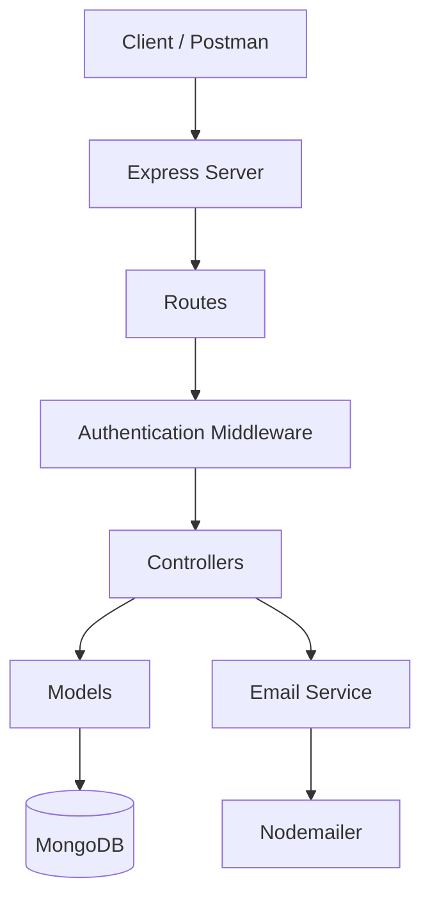
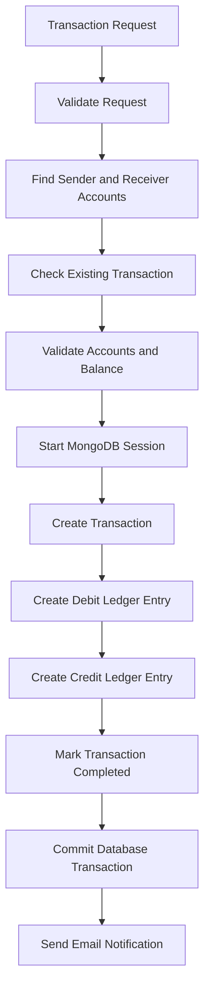
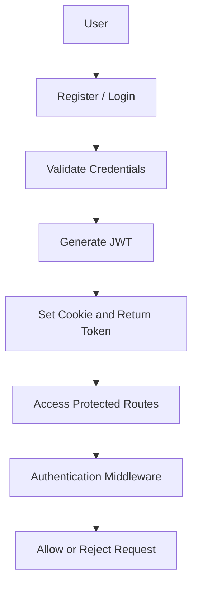

# 💸 Backend Ledger

### Money moves. Every transaction leaves a trace.

A backend ledger application built using **Node.js, Express.js, MongoDB, and Mongoose**. It provides user authentication, account management, fund transfers, and a double-entry ledger system to maintain a record of financial transactions.

🌐 **Live API:** [https://backend-ledger-n0rp.onrender.com](https://backend-ledger-n0rp.onrender.com)

---

## ✨ Features

- **User Authentication** – User registration and login using JWT.
- **Password Security** – Password hashing using bcrypt.
- **Account Management** – Create and retrieve user accounts.
- **Balance Tracking** – Retrieve account balances.
- **Fund Transfers** – Transfer funds between accounts.
- **Double-Entry Ledger** – Record corresponding debit and credit entries for fund transfers.
- **Initial Funds** – Dedicated system-user endpoint for initial fund allocation.
- **Transaction Tracking** – Maintain transaction records and statuses.
- **Idempotency Key** – Support for transaction idempotency keys to identify repeated requests.
- **Email Notifications** – Registration emails using Nodemailer.
- **MongoDB Transactions** – Use database sessions to group related transaction and ledger operations.

---

## 🛠️ Tech Stack

| Technology | Purpose |
|---|---|
| Node.js | JavaScript runtime |
| Express.js | Backend framework |
| MongoDB | Database |
| Mongoose | MongoDB object modelling |
| JWT | Authentication |
| bcrypt | Password hashing |
| Nodemailer | Email notifications |
| dotenv | Environment configuration |

---

## 🏗️ System Architecture

The application follows a modular backend architecture, separating routes, middleware, controllers, models, and services.



### Transaction Workflow

A fund transfer creates a transaction record and corresponding debit and credit ledger entries within a MongoDB session.



---

## 📁 Project Structure

```text
Backend-Ledger/
│
├── src/
│   ├── config/
│   │   └── db.js
│   │
│   ├── controllers/
│   │   ├── account.controller.js
│   │   ├── auth.controller.js
│   │   └── transaction.controller.js
│   │
│   ├── middleware/
│   │   └── auth.middleware.js
│   │
│   ├── models/
│   │   ├── account.model.js
│   │   ├── blackList.model.js
│   │   ├── ledger.model.js
│   │   ├── transaction.model.js
│   │   └── user.model.js
│   │
│   ├── routes/
│   │   ├── accounts.routes.js
│   │   ├── auth.routes.js
│   │   └── transaction.routes.js
│   │
│   ├── services/
│   │   └── email.service.js
│   │
│   └── app.js
│
├── server.js
├── package.json
├── package-lock.json
└── README.md
```

---

## 🚀 Getting Started

### Prerequisites

- Node.js
- npm
- MongoDB database
- Git

### 1. Clone the repository

```bash
git clone https://github.com/mayank03s/Backend-Ledger.git
```

### 2. Navigate to the project directory

```bash
cd Backend-Ledger
```

### 3. Install dependencies

```bash
npm install
```

### 4. Configure environment variables

Create a `.env` file in the root directory of the project.

```env
MONGO_URI=your_mongodb_connection_string
JWT_SECRET=your_jwt_secret

EMAIL_USER= your_email
CLIENT_ID= your_google_oauth_client_id
CLIENT_SECRET= your_google_oauth_client_secret
REFRESH_TOKEN= your_google_oauth_refresh_token
```

Replace the placeholder values with your actual credentials.

**Important:** Never commit your `.env` file or expose your database credentials, JWT secret, or email credentials publicly.

### 5. Run the application

Start the server:

```bash
npm start
```

For development:

```bash
npm run dev
```

The application currently listens on port `3000`.

---

## 📡 API Documentation

### Base URL

**Production:**

```text
https://backend-ledger-n0rp.onrender.com
```

**Local:**

```text
http://localhost:3000
```

### 1. Health Check

| Method | Endpoint | Description |
|---|---|---|
| GET | `/` | Check API availability |

### 2. Authentication Routes

| Method | Endpoint | Description |
|---|---|---|
| POST | `/api/auth/register` | Register a new user |
| POST | `/api/auth/login` | Log in an existing user |
| POST | `/api/auth/logout` | Log out a user |

**Register – Request Body**

```json
{
  "name": "John Doe",
  "email": "john@example.com",
  "password": "your_password"
}
```

**Login – Request Body**

```json
{
  "email": "john@example.com",
  "password": "your_password"
}
```

### 3. Account Routes

All account routes require user authentication.

| Method | Endpoint | Description |
|---|---|---|
| POST | `/api/accounts/` | Create a new account |
| GET | `/api/accounts/` | Retrieve logged-in user's accounts |
| GET | `/api/accounts/balance/:accountId` | Retrieve account balance |

**Get Account Balance**

```text
GET /api/accounts/balance/ACCOUNT_ID
```

The account must belong to the authenticated user.

### 4. Transaction Routes

| Method | Endpoint | Description | Authentication |
|---|---|---|---|
| POST | `/api/transaction/` | Create a fund transfer | User authentication |
| POST | `/api/transaction/system/initial-funds` | Initialise account funds | System-user authentication |

**Create Transaction – Request Body**

```json
{
  "fromAccount": "SENDER_ACCOUNT_ID",
  "toAccount": "RECEIVER_ACCOUNT_ID",
  "amount": 500,
  "idempotencyKey": "unique-transaction-key"
}
```

**Initial Funds – Request Body**

```json
{
  "toAccount": "RECEIVER_ACCOUNT_ID",
  "amount": 1000,
  "idempotencyKey": "initial-funds-key"
}
```

The initial-funds endpoint is restricted to an authenticated system user.

---

## 🔐 Authentication

The application uses JSON Web Tokens (JWT) for user authentication.

- A JWT is generated after successful registration or login.
- Tokens have an expiration period of 3 days.
- Tokens are returned in the response and set as cookies.
- Protected routes use authentication middleware.
- Logout supports token blacklisting.

### Authentication Flow



---

## 📒 Understanding the Double-Entry Ledger

The ledger records the two sides of a fund transfer.

For example, when User A transfers ₹500 to User B:

| Account | Entry Type | Amount |
|---|---|---:|
| User A | Debit | ₹500 |
| User B | Credit | ₹500 |

Each transfer creates corresponding debit and credit ledger entries, providing a record of money movement between accounts.

The transaction model tracks the overall transaction, while the ledger model stores the individual account-level entries.

---

## 🌍 Live Deployment

The backend is deployed on **Render**.

🔗 **Live API:** [Backend Ledger](https://backend-ledger-n0rp.onrender.com)

You can visit the root endpoint to check whether the service is running.

---

## 🧪 API Testing

API endpoints can be tested using [Postman](https://www.postman.com/).

A Postman collection will be added soon to this repository to make it easier to test authentication, account management, and transaction workflows.

---

## 👨‍💻 Author

**Mayank Singh**

GitHub: [@mayank03s](https://github.com/mayank03s)

---

⭐ If you find this project interesting, consider giving the repository a star!